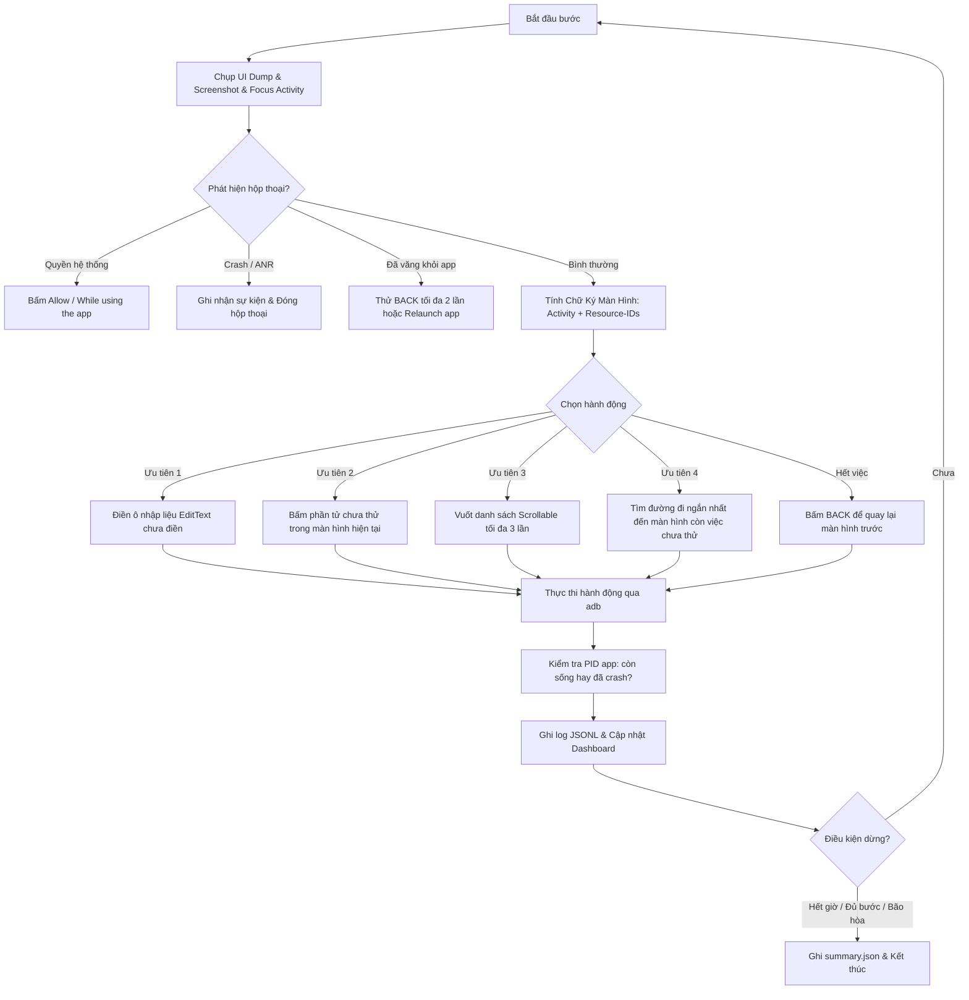

# SimCrawler 🚀

<p align="center">
  <a href="README.md"><b>🇻🇳 Tiếng Việt</b></a> •
  <a href="README_EN.md">🇺🇸 English</a> •
  <a href="README_ZH.md">🇨🇳 简体中文</a>
</p>

<p align="center">
  <a href="https://nodejs.org/"></a>
  <a href="https://www.typescriptlang.org/"></a>
  <a href="LICENSE"></a>
  
  <a href="https://www.electronjs.org/"></a>
</p>

**SimCrawler** là công cụ tự động khám phá và kiểm thử khỉ (automated exploratory & monkey crawler) dành cho ứng dụng Android trên **nhiều thiết bị / emulator song song**.

Hệ thống hoạt động thuần túy dựa trên `adb` + `uiautomator`, không phụ thuộc vào LLM, không cần Appium cồng kềnh, không stream video tốn băng thông. SimCrawler tự động xây dựng đồ thị màn hình (screen transition graph), ghi log từng bước ở định dạng JSONL, lưu trữ ảnh chụp và logcat khi gặp crash/ANR, đồng thời cung cấp cả **Dashboard Web theo thời gian thực** lẫn **Ứng dụng Desktop Electron** tiện lợi.

---

## 📑 Mục Lục

- [Tính Năng Nổi Bật](#-tính-năng-nổi-bật)
- [Kiến Trúc & Cách Hoạt Động](#-kiến-trúc--cách-hoạt-động)
- [Yêu Cầu Hệ Thống](#-yêu-cầu-hệ-thống)
- [Cài Đặt](#-cài-đặt)
- [Hướng Dẫn Sử Dụng](#-hướng-dẫn-sử-dụng)
  - [Chạy CLI](#1-chạy-dạng-cli)
  - [Chạy Ứng Dụng Desktop (Electron)](#2-chạy-dạng-ứng-dụng-desktop-electron)
  - [Chế Độ Demo Giả Lập](#3-chế-độ-demo-thiết-bị-giả-không-cần-máy-thật)
- [Cấu Hình config.json](#-cấu-hình-configjson)
  - [Tùy chọn chung](#tùy-chọn-chung)
  - [Tự khởi động Android Emulator (AVD)](#tự-khởi-động-android-emulator-avd)
- [Kết Quả & Định Dạng Log](#-kết-quả--định-dạng-log)
- [Kiểm Thử & Đóng Gói](#-kiểm-thử--đóng-gói)
- [Giới Hạn & Lưu Ý](#-giới-hạn--lưu-ý)
- [Giấy Phép (License)](#-giấy-phép-license)

---

## ✨ Tính Năng Nổi Bật

- **Song song nhiều thiết bị:** Chạy đồng thời trên 2 (hoặc nhiều) thiết bị/emulator. Mỗi thiết bị chạy luồng độc lập với seed ngẫu nhiên khác nhau để tối đa hóa diện tích bao phủ (screen coverage).
- **Thuật toán đồ thị thông minh (Heuristic Graph Exploration):**
  - Tính toán **chữ ký màn hình (screen signature)** chuẩn xác dựa trên Activity và cấu trúc `resource-id` / `class` của các phần tử tương tác (loại bỏ text động như đồng hồ, số đếm để không bị nhận diện nhầm màn hình mới).
  - Tự động tìm đường quay lại các màn hình còn phần tử chưa thử thay vì chỉ bấm BACK ngẫu nhiên.
  - Tự động điền dữ liệu mẫu vào các trường nhập liệu (`EditText`) và bỏ qua các ô mật khẩu.
- **Tự động quản lý Android Emulator:** Tự động phát hiện AVD trên máy, bật emulator song song, chờ hệ thống khởi động hoàn tất (`boot_completed`), hỗ trợ chế độ headless và read-only (chia sẻ snapshot).
- **Cơ chế an toàn (Safety First & Blacklist):**
  - Chặn các nút nguy hiểm như Đăng xuất, Thanh toán, Xóa dữ liệu thông qua cấu hình blacklist.
  - Tự động vượt qua các hộp thoại xin quyền hệ thống ("Allow", "While using the app").
  - Tự động nhận diện và đóng các hộp thoại Crash/ANR của hệ thống.
  - Tự động mở lại ứng dụng (Auto-recovery / Relaunch) nếu lỡ thoát ra màn hình Home hoặc chuyển sang app khác.
- **Giám sát & Báo cáo toàn diện:**
  - Ghi log JSONL chi tiết từng bước (thời gian, màn hình, thao tác, tọa độ, trạng thái sống/chết của app).
  - Tự động chụp ảnh trước và sau khi xảy ra sự cố, lưu kèm `logcat -b crash`.
  - Tổng kết báo cáo định dạng `summary.json` khi kết thúc phiên chạy.
- **Giao diện trực quan kép (Dual Interface):**
  - **Web Dashboard:** Xem tiến trình, ảnh chụp màn hình gần nhất, lịch sử hành động qua SSE tại `http://127.0.0.1:8765`.
  - **Desktop App (Electron):** Ứng dụng Desktop hoàn chỉnh với khả năng tự dò thiết bị, gợi ý package, chọn AVD và xem log trực tiếp mà không cần mở trình duyệt.

---

## 🧠 Kiến Trúc & Cách Hoạt Động

Mỗi chu kỳ bước (step) của SimCrawler diễn ra như sau:



---

## 📦 Yêu Cầu Hệ Thống

1. **Node.js**: Phiên bản 20 trở lên (`node >= 20.0.0`).
2. **Android SDK Platform-Tools (`adb`)**:
   - Được thêm vào `PATH`, hoặc thiết lập biến môi trường `ADB_PATH` / `ANDROID_HOME` / `ANDROID_SDK_ROOT`.
3. **Thiết bị / Emulator Android**:
   - Ít nhất 2 thiết bị Android thật (đã bật USB Debugging) hoặc 2 Android Virtual Devices (AVD).
   - Ứng dụng cần test đã được cài đặt sẵn trên các thiết bị.

---

## 🔧 Cài Đặt

Clone repository và cài đặt các dependencies:

```bash
git clone https://github.com/khangdev20/SimCrawler.git
cd SimCrawler
npm install
```

---

## 🚀 Hướng Dẫn Sử Dụng

### 1. Chạy dạng CLI

Cấu hình package và danh sách serial thiết bị trong file `config.json` (xem chi tiết mục [Cấu hình](#-cấu-hình-configjson)).

```bash
# Chạy crawler thực tế
npm start

# Ghi đè thời gian chạy tối đa (ví dụ 3 phút)
npm start -- --minutes 3

# Liệt kê danh sách AVD có trên máy tính
npm start -- --list-avds

# Tự động khởi động emulator đã khai báo trong config rồi mới crawl
npm start -- --start-emulators
```

Sau khi khởi chạy, mở trình duyệt tại:
```
http://127.0.0.1:8765
```

> **Mẹo dừng chương trình:** Bấm `Ctrl + C` một lần để dừng nhẹ nhàng (vẫn xuất báo cáo `summary.json`), bấm hai lần để thoát cưỡng bức ngay lập tức.

---

### 2. Chạy dạng Ứng Dụng Desktop (Electron)

SimCrawler hỗ trợ ứng dụng Desktop nguyên bản với đầy đủ tính năng: tự dò thiết bị kết nối, danh sách gợi ý package từ máy, công tắc tự bật AVD, Start/Stop và xem log trực quan:

```bash
# Build bundle Electron
npm run app:build

# Chạy app Desktop
npm run app

# Chạy app Desktop ở chế độ giả lập (thử giao diện mà không cần adb hay emulator)
SIMCRAWLER_FAKE=1 npm run app
```

Đóng gói file cài đặt Desktop:
```bash
npm run dist          # Tự động đóng gói theo hệ điều hành hiện tại
npm run dist:mac      # Đóng gói (.dmg, .zip) cho macOS
npm run dist:win      # Đóng gói installer (.exe qua NSIS) và bản Portable cho Windows
```
File đóng gói sẽ nằm trong thư mục `release/`.

> **Lưu ý trên macOS (Bản build chưa ký):** Lần đầu mở file `.dmg` hoặc `.app`, bạn bấm **Chuột phải → Open**, hoặc chạy lệnh Terminal:
> ```bash
> xattr -cr /Applications/SimCrawler.app
> ```

> **Lưu ý trên Windows:** Bộ cài đặt NSIS (`.exe`) cho phép tùy chọn thư mục cài đặt và tự động tạo shortcut ở Desktop và Start Menu. Đường dẫn Android SDK trên Windows (`%LOCALAPPDATA%\Android\Sdk`) được hệ thống tự động nhận diện.

---

### 3. Chế độ Demo (Thiết bị giả, không cần máy thật)

Bạn có thể chạy thử nghiệm toàn bộ luồng khám phá, thuật toán đồ thị và Dashboard ngay trên môi trường giả lập (`FakeDevice`) mà không cần kết nối bất kỳ điện thoại hay emulator nào:

```bash
npm run demo
```

---

## ⚙️ Cấu Hình config.json

Tạo hoặc chỉnh sửa file `config.json` tại thư mục gốc:

```json
{
  "package": "com.example.app",
  "devices": ["emulator-5554", "emulator-5556"],
  "maxMinutes": 10,
  "blacklist": [
    "logout", "log out", "sign out",
    "delete", "remove",
    "pay", "purchase", "buy", "checkout",
    "uninstall", "reset"
  ],
  "stepDelayMs": 800,
  "launchWaitMs": 2000,
  "staleStepsBeforeRelaunch": 15,
  "maxSteps": 0,
  "dashboardPort": 8765,
  "seed": 1337,
  "outDir": "logs"
}
```

### Tùy chọn chung

| Khóa | Mặc định | Ý nghĩa |
|---|---|---|
| `package` | *Bắt buộc* | Tên Android Package của ứng dụng mục tiêu (ví dụ: `com.example.app`). |
| `devices` | *Bắt buộc* | Mảng chứa serial các thiết bị/cổng emulator cần chạy song song. |
| `maxMinutes` | `10` | Thời gian chạy tối đa (phút). |
| `blacklist` | `[]` | Mảng chuỗi ký tự cấm bấm (không phân biệt hoa thường). Khớp với text, content-desc, resource-id hoặc text của các phần tử con. Thà bỏ sót còn hơn bấm nhầm các nút nguy hiểm. |
| `stepDelayMs` | `800` | Thời gian chờ (ms) sau mỗi hành động tap/swipe. |
| `launchWaitMs` | `2000` | Thời gian chờ (ms) sau khi khởi động app. |
| `staleStepsBeforeRelaunch` | `15` | Số bước liên tiếp không khám phá được màn hình mới trước khi tự mở lại app. |
| `maxSteps` | `0` | Giới hạn số bước thực hiện (`0` nghĩa là không giới hạn bước, chỉ dừng theo thời gian hoặc khi bão hòa). |
| `dashboardPort` | `8765` | Cổng HTTP của Dashboard (tự động thử cổng kế tiếp nếu bị bận). |
| `seed` | `1337` | Hạt giống ngẫu nhiên ban đầu (các máy khác nhau sẽ tự động lệch seed để đi theo các nhánh khác nhau). |
| `outDir` | `"logs"` | Thư mục ghi log kết quả. |
| `emulators` | *Không có* | Cấu hình tự động bật emulator AVD trước khi chạy. |

---

### Tự khởi động Android Emulator (AVD)

Để SimCrawler tự bật emulator AVD trước khi crawl, thêm khối `emulators` vào `config.json`:

```json
{
  "package": "com.example.app",
  "devices": ["emulator-5554", "emulator-5556"],
  "emulators": {
    "autoStart": true,
    "avds": {
      "emulator-5554": "Pixel_8_API_34",
      "emulator-5556": "Pixel_8_API_34_2"
    },
    "headless": false,
    "bootTimeoutSec": 180,
    "closeWhenDone": false,
    "readOnly": false
  }
}
```

| Khóa | Mặc định | Ý nghĩa |
|---|---|---|
| `autoStart` | `false` | Tự động bật các AVD trong `avds` khi chạy. Cờ `--start-emulators` sẽ kích hoạt tính năng này kể cả khi config để `false`. |
| `avds` | `{}` | Bản đồ ánh xạ `serial` → `Tên AVD`. Serial phải có định dạng `emulator-<cổng_chẵn>`. |
| `headless` | `false` | Chạy emulator ẩn giao diện (thêm cờ `-no-window`), tiết kiệm tài nguyên. |
| `bootTimeoutSec` | `180` | Thời gian tối đa (giây) chờ mỗi máy khởi động hoàn tất. |
| `closeWhenDone` | `false` | Tự tắt các emulator **do SimCrawler bật** sau khi hoàn thành hoặc khi dừng. |
| `readOnly` | `false` | Chạy ở chế độ read-only (thêm cờ `-read-only`). **Bắt buộc** nếu 2 serial cùng trỏ tới một tên AVD. |

---

## 📊 Kết Quả & Định Dạng Log

Sau mỗi phiên chạy, dữ liệu được lưu tại thư mục `logs/<thời-điểm-chạy>/`:

```text
logs/2026-10-12T01-05-00/
├── emulator-5554.jsonl     # Chi tiết từng bước của thiết bị 1
├── emulator-5556.jsonl     # Chi tiết từng bước của thiết bị 2
├── summary.json            # Tổng kết số bước, màn hình duy nhất, crash...
├── shots/                  # Ảnh chụp màn hình trước/sau mỗi crash/ANR
└── crashes/                # File logcat chi tiết của mỗi crash
```

### Định dạng 1 dòng trong file JSONL:
```json
{
  "t": "2026-10-12T01:05:03.120Z",
  "dev": "emulator-5554",
  "step": 42,
  "activity": "SettingsActivity",
  "sig": "1a1f63e1",
  "action": {
    "type": "tap",
    "x": 180,
    "y": 210,
    "id": "com.example.app:id/btn_bug",
    "label": "Trigger bug"
  },
  "newScreen": false,
  "alive": false,
  "event": "crash",
  "note": "process đã chết: java.lang.IllegalStateException: ...",
  "shot": "shots/emulator-5554-s42-crash.png",
  "shotAfter": "shots/emulator-5554-s42-crash-after.png",
  "crashLog": "crashes/emulator-5554-s42-crash.log"
}
```

Các loại sự kiện (`event`):
- `start`: Bắt đầu lượt chạy.
- `relaunch`: Khởi động lại app khi bị văng ra ngoài hoặc bị kẹt.
- `crash`: Ứng dụng bị sập / process bị kết thúc đột ngột.
- `anr`: Xuất hiện thông báo ứng dụng không phản hồi.
- `left_app`: Rơi ra khỏi phạm vi package mục tiêu.
- `stuck`: Không tìm thấy phần tử khả dĩ để tương tác.
- `permission`: Tự động chấp thuận hộp thoại quyền hệ thống.
- `dialog_dismissed`: Đóng hộp thoại cảnh báo hệ thống.
- `dump_failed`: Lỗi khi trích xuất cây UI qua `uiautomator dump`.
- `error`: Lỗi ngoại lệ trong quá trình thực thi.

---

## 🧪 Kiểm Thử & Đóng Gói

Dự án đi kèm bộ unit test và integration test hoàn chỉnh:

```bash
# Chạy toàn bộ 38 test cases
npm test

# Kiểm tra kiểu dữ liệu với TypeScript
npm run typecheck

# Build các bundle ứng dụng Electron
npm run app:build

# Đóng gói bộ cài đặt Desktop
npm run dist
```

---

## ⚠️ Giới Hạn & Lưu Ý

- **Xác thực / Đăng nhập:** SimCrawler không tự động đăng nhập tài khoản phức tạp (OTP, Captcha...). Khuyến nghị đăng nhập sẵn tài khoản trên các thiết bị trước khi bắt đầu phiên crawl.
- **Flutter / React Native / Compose / WebView / Canvas:** Nếu ứng dụng không gắn `resource-id` hoặc `testTag`, cây UI phân tích từ `uiautomator dump` sẽ ít thông tin. Trong trường hợp đó, hệ thống sẽ tự động dùng lưới tọa độ để tính chữ ký màn hình.
- **Cuộn danh sách (Scrollable feeds):** Mỗi danh sách cuộn chỉ được vuốt tối đa 3 lần/màn hình để tránh bị kẹt trong các luồng dữ liệu vô tận (infinite feed).
- **Apple Silicon (macOS M-series):** Khi dùng tính năng tự bật Emulator, hãy chọn các system image kiến trúc `arm64-v8a`.
- **Bảo mật Dashboard:** Server Dashboard chỉ lắng nghe trên `127.0.0.1` và từ chối các `Host` lạ để đảm bảo ảnh chụp màn hình ứng dụng không bị lộ ra mạng bên ngoài.

---

## 📄 Giấy Phép (License)

Dự án này được phát hành dưới giấy phép mã nguồn mở **[MIT License](LICENSE)**.

Bản quyền © 2026 **[khangdev20](https://github.com/khangdev20)**.

Toàn quyền sử dụng, sửa đổi, phân phối cho mục đích cá nhân và thương mại. Xem chi tiết trong file [LICENSE](LICENSE).
