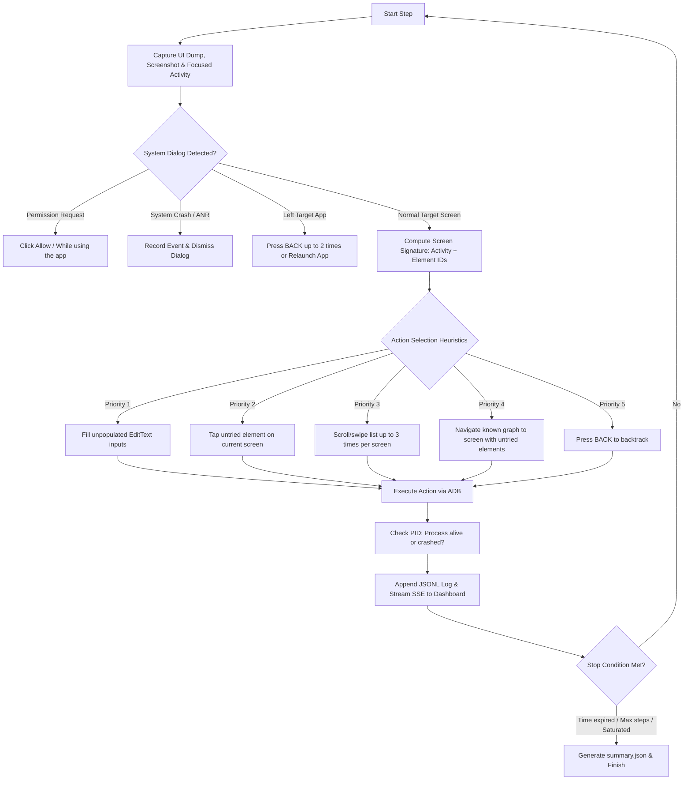

# SimCrawler 🚀

<p align="center">
  <a href="README.md">🇻🇳 Tiếng Việt</a> •
  <a href="README_EN.md"><b>🇺🇸 English</b></a> •
  <a href="README_ZH.md">🇨🇳 简体中文</a>
</p>

<p align="center">
  <a href="https://nodejs.org/"></a>
  <a href="https://www.typescriptlang.org/"></a>
  <a href="LICENSE"></a>
  
  <a href="https://www.electronjs.org/"></a>
</p>

**SimCrawler** is an automated exploratory and monkey crawler for Android applications running across **multiple devices / emulators in parallel**.

Built natively with `adb` + `uiautomator`, SimCrawler requires no heavy LLMs, no Appium overhead, and no video streaming. It autonomously builds screen transition graphs, records step-by-step telemetry in JSONL format, captures screenshots and logcats on crashes/ANRs, and provides both a **real-time Web Dashboard** and a **standalone Electron Desktop App**.

---

## 📑 Table of Contents

- [Key Features](#-key-features)
- [Architecture & How It Works](#-architecture--how-it-works)
- [Prerequisites](#-prerequisites)
- [Installation](#-installation)
- [Usage Guide](#-usage-guide)
  - [CLI Mode](#1-cli-mode)
  - [Desktop App (Electron)](#2-desktop-app-electron)
  - [Demo Mode (Mock / No Device Required)](#3-demo-mode-mock-device-without-hardware)
- [Configuration (config.json)](#-configuration-configjson)
  - [General Settings](#general-settings)
  - [Automatic Emulator (AVD) Management](#automatic-emulator-avd-management)
- [Results & Log Format](#-results--log-format)
- [Testing & Building](#-testing--building)
- [Known Limitations & Tips](#-known-limitations--tips)
- [License](#-license)

---

## ✨ Key Features

- **Multi-Device Parallel Crawling:** Runs concurrently across 2 (or more) physical devices/emulators. Each instance executes an independent loop with unique random seeds to maximize coverage.
- **Heuristic Graph Exploration:**
  - Calculates accurate **screen signatures** using the active Activity and the set of `resource-id` / `class` attributes of interactive elements (filtering out volatile text like clocks and counters to avoid false new screens).
  - Traverses the shortest known path back to screens containing untried elements rather than blindly pressing BACK.
  - Automatically fills sample text into inputs (`EditText`) while securely ignoring password fields.
- **Automated Emulator Management:** Automatically detects host AVDs, boots emulators in parallel, monitors boot completion (`sys.boot_completed`), supports headless mode (`-no-window`), and read-only mode for shared snapshots.
- **Safety First & Blacklist Protection:**
  - Configurable keyword blacklist preventing clicks on sensitive operations (Logout, Delete, Purchase, Reset).
  - Automatically grants system permission dialogs ("Allow", "While using the app").
  - Detects and dismisses system Crash/ANR dialogs.
  - Auto-recovery / relaunch mechanism if the device wanders away from the target application package.
- **Comprehensive Logging & Telemetry:**
  - Writes structured JSONL records for every action (timestamp, screen signature, tap coordinates, process liveness).
  - Automatically saves pre- and post-crash screenshots along with `logcat -b crash` outputs.
  - Generates comprehensive run reports (`summary.json`).
- **Dual Visual Interface:**
  - **Web Dashboard:** Real-time progress, latest screenshots, and SSE-driven activity stream at `http://127.0.0.1:8765`.
  - **Desktop App (Electron):** Standalone native UI featuring automatic device discovery, installed package suggestions, AVD selector, and live logs.

---

## 🧠 Architecture & How It Works

Each exploration step in SimCrawler follows an intelligent heuristic loop:



---

## 📦 Prerequisites

1. **Node.js**: Version 20 or higher (`node >= 20.0.0`).
2. **Android SDK Platform-Tools (`adb`)**:
   - Available in `PATH`, or configured via `ADB_PATH` / `ANDROID_HOME` / `ANDROID_SDK_ROOT`.
3. **Android Device / Emulator**:
   - At least 2 physical Android devices (with USB Debugging enabled) or 2 Android Virtual Devices (AVD).
   - Target application installed on all testing devices.

---

## 🔧 Installation

Clone the repository and install dependencies:

```bash
git clone https://github.com/khangdev20/SimCrawler.git
cd SimCrawler
npm install
```

---

## 🚀 Usage Guide

### 1. CLI Mode

Configure the target package and device serials in `config.json` (see [Configuration](#-configuration-configjson)).

```bash
# Start standard crawl
npm start

# Override maximum run duration (e.g. 3 minutes)
npm start -- --minutes 3

# List available AVDs installed on the system
npm start -- --list-avds

# Automatically boot configured emulators before crawling
npm start -- --start-emulators
```

Once launched, open the dashboard in your browser:
```
http://127.0.0.1:8765
```

> **Graceful Stop:** Press `Ctrl + C` once to gracefully terminate and produce `summary.json`. Press twice to force exit immediately.

---

### 2. Desktop App (Electron)

SimCrawler includes a complete native desktop application:

```bash
# Build Electron bundle
npm run app:build

# Launch desktop app
npm run app

# Run desktop app in mock mode (preview UI without ADB or emulators)
SIMCRAWLER_FAKE=1 npm run app
```

Package production desktop installers (`.dmg`, `.zip` on macOS):
```bash
npm run dist
```
Packaged assets will be located in the `release/` directory.

> **macOS Note (Unsigned binary):** On first run of `.dmg` or `.app`, right-click → **Open**, or run:
> ```bash
> xattr -cr /Applications/SimCrawler.app
> ```

---

### 3. Demo Mode (Mock device without hardware)

You can evaluate the complete crawl workflow, graph exploration algorithm, and Dashboard without connecting any real device or emulator using the built-in `FakeDevice`:

```bash
npm run demo
```

---

## ⚙️ Configuration (config.json)

Edit `config.json` in the root directory:

```json
{
  "package": "com.example.app",
  "devices": ["emulator-5554", "emulator-5556"],
  "maxMinutes": 10,
  "blacklist": [
    "logout", "log out", "sign out",
    "delete", "remove",
    "pay", "purchase", "buy", "checkout",
    "uninstall", "reset"
  ],
  "stepDelayMs": 800,
  "launchWaitMs": 2000,
  "staleStepsBeforeRelaunch": 15,
  "maxSteps": 0,
  "dashboardPort": 8765,
  "seed": 1337,
  "outDir": "logs"
}
```

### General Settings

| Key | Default | Description |
|---|---|---|
| `package` | *Required* | Android package name of the target application (e.g. `com.example.app`). |
| `devices` | *Required* | Array of device serials or emulator ports to run concurrently. |
| `maxMinutes` | `10` | Maximum crawl time in minutes. |
| `blacklist` | `[]` | Substring blacklist (case-insensitive). Matches text, content-desc, resource-id, or child node text. Matched elements will never be clicked. |
| `stepDelayMs` | `800` | Delay in milliseconds after each action. |
| `launchWaitMs` | `2000` | Wait duration in milliseconds after app launch. |
| `staleStepsBeforeRelaunch` | `15` | Consecutive steps without discovering a new screen before restarting the app. |
| `maxSteps` | `0` | Maximum steps limit (`0` means unlimited; stops by time or saturation). |
| `dashboardPort` | `8765` | Dashboard HTTP port (automatically increments if port is occupied). |
| `seed` | `1337` | Random seed base (each device automatically offsets seeds for divergence). |
| `outDir` | `"logs"` | Output directory relative to config file. |
| `emulators` | *None* | Configuration block for automatic AVD lifecycle management. |

---

### Automatic Emulator (AVD) Management

Add the `emulators` block to `config.json` to have SimCrawler automatically launch emulators:

```json
{
  "package": "com.example.app",
  "devices": ["emulator-5554", "emulator-5556"],
  "emulators": {
    "autoStart": true,
    "avds": {
      "emulator-5554": "Pixel_8_API_34",
      "emulator-5556": "Pixel_8_API_34_2"
    },
    "headless": false,
    "bootTimeoutSec": 180,
    "closeWhenDone": false,
    "readOnly": false
  }
}
```

| Key | Default | Description |
|---|---|---|
| `autoStart` | `false` | Automatically launch AVDs before crawling. Flag `--start-emulators` overrides this to true. |
| `avds` | `{}` | Mapping of `serial` → `AVD Name`. Serial must match `emulator-<even_port>`. |
| `headless` | `false` | Run emulator in background without UI (`-no-window`), saving GPU/CPU resources. |
| `bootTimeoutSec` | `180` | Maximum wait time in seconds for each device to complete boot. |
| `closeWhenDone` | `false` | Terminate only emulators launched by SimCrawler upon completion or interruption. |
| `readOnly` | `false` | Append `-read-only`. **Required** if multiple serials share the same AVD image. |

---

## 📊 Results & Log Format

Each session writes output into `logs/<session-timestamp>/`:

```text
logs/2026-10-12T01-05-00/
├── emulator-5554.jsonl     # Detailed action log for device 1
├── emulator-5556.jsonl     # Detailed action log for device 2
├── summary.json            # Run summary: steps, unique screens, crashes...
├── shots/                  # Pre/post crash and ANR screenshots
└── crashes/                # Detailed logcat crash dumps
```

### JSONL Log Record Example:
```json
{
  "t": "2026-10-12T01:05:03.120Z",
  "dev": "emulator-5554",
  "step": 42,
  "activity": "SettingsActivity",
  "sig": "1a1f63e1",
  "action": {
    "type": "tap",
    "x": 180,
    "y": 210,
    "id": "com.example.app:id/btn_bug",
    "label": "Trigger bug"
  },
  "newScreen": false,
  "alive": false,
  "event": "crash",
  "note": "process terminated: java.lang.IllegalStateException: ...",
  "shot": "shots/emulator-5554-s42-crash.png",
  "shotAfter": "shots/emulator-5554-s42-crash-after.png",
  "crashLog": "crashes/emulator-5554-s42-crash.log"
}
```

Supported event types (`event`):
- `start`: Run started.
- `relaunch`: App relaunched after deviation or stale loop.
- `crash`: Process died unexpectedly or uncaught exception detected.
- `anr`: Application Not Responding system dialog detected.
- `left_app`: Target application lost focus.
- `stuck`: No interactive element found.
- `permission`: Auto-accepted system permission request.
- `dialog_dismissed`: System warning or crash dialog dismissed.
- `dump_failed`: `uiautomator dump` extraction failure.
- `error`: Uncaught runtime execution error.

---

## 🧪 Testing & Building

SimCrawler includes a comprehensive unit and integration test suite:

```bash
# Run all 37 test cases
npm test

# Verify TypeScript types
npm run typecheck

# Build Electron bundles
npm run app:build

# Package desktop release
npm run dist
```

---

## ⚠️ Known Limitations & Tips

- **Authentication / Login:** Complex auth flows (Captcha, OTP) are not handled automatically. Pre-authenticate test accounts on all devices prior to running the crawl.
- **Flutter / React Native / Compose / WebViews / Canvas:** When elements lack explicit `resource-id` or `testTag`, UI trees may be coarse. SimCrawler automatically falls back to coordinate grid hashing for screen signatures.
- **Infinite Feeds / Lists:** Scrollable lists are limited to a maximum of 3 swipes per screen to avoid getting trapped in infinite timelines.
- **Apple Silicon (macOS M-series):** When configuring emulators, always select `arm64-v8a` system images.
- **Dashboard Security:** The dashboard server binds exclusively to `127.0.0.1` and blocks foreign `Host` headers to prevent sensitive screenshot exfiltration.

---

## 📄 License

This project is licensed under the open-source **[MIT License](LICENSE)**.

Copyright © 2026 **[khangdev20](https://github.com/khangdev20)**.
