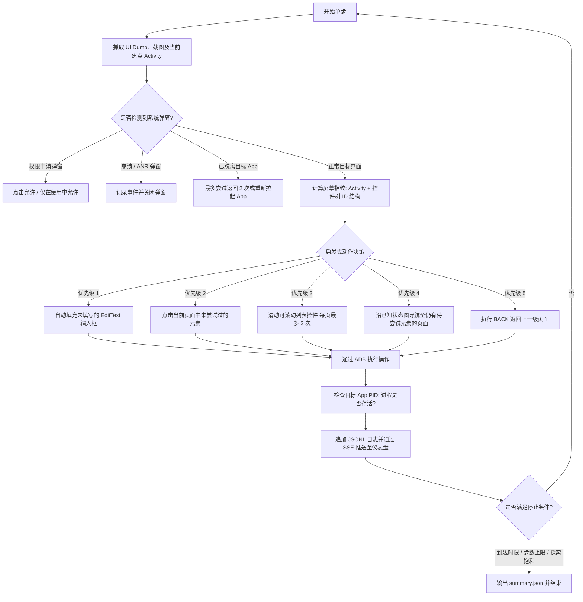

# SimCrawler 🚀

<p align="center">
  <a href="README.md">🇻🇳 Tiếng Việt</a> •
  <a href="README_EN.md">🇺🇸 English</a> •
  <a href="README_ZH.md"><b>🇨🇳 简体中文</b></a>
</p>

<p align="center">
  <a href="https://nodejs.org/"></a>
  <a href="https://www.typescriptlang.org/"></a>
  <a href="LICENSE"></a>
  
  <a href="https://www.electronjs.org/"></a>
</p>

**SimCrawler** 是一款面向 Android 应用程序的**多设备/模拟器并行自动化探索与猴子测试（Monkey & Exploratory Crawler）工具**。

本项目原生基于 `adb` + `uiautomator` 实现，无需调用大语言模型（LLM），无需安装笨重的 Appium，亦无需推流视频。SimCrawler 能够自动构建页面状态转移图，将每一步操作记录为 JSONL 结构化日志，在发生 Crash/ANR 时自动截屏并抓取 logcat，同时提供**实时 Web 仪表盘**与**独立 Electron 桌面端应用**。

---

## 📑 目录

- [核心特性](#-核心特性)
- [架构与工作原理](#-架构与工作原理)
- [环境依赖](#-环境依赖)
- [安装指南](#-安装指南)
- [快速上手](#-快速上手)
  - [CLI 命令行模式](#1-cli-命令行模式)
  - [Electron 桌面客户端](#2-electron-桌面客户端)
  - [Demo 演示模式（无需真机/模拟器）](#3-demo-演示模式虚拟设备无需硬件)
- [配置文件 config.json 详解](#-配置文件-configjson-详解)
  - [通用配置项](#通用配置项)
  - [自动管理 Android 模拟器 (AVD)](#自动管理-android-模拟器-avd)
- [运行结果与日志规范](#-运行结果与日志规范)
- [自动化测试与构建打包](#-自动化测试与构建打包)
- [已知限制与注意事项](#-已知限制与注意事项)
- [开源许可证 (License)](#-开源许可证-license)

---

## ✨ 核心特性

- **多设备并行遍历：** 支持同时在 2 台（或多台）真机/模拟器上并行执行。每台设备使用独立的随机种子（Seed）以探索不同的页面分支，极大提升覆盖率。
- **启发式图遍历算法（Heuristic Graph Exploration）：**
  - **精准屏幕指纹算法：** 结合当前 Activity 及可交互控件的 `resource-id` / `class` 结构计算哈希（自动剔除时间、计数器等动态文本，避免误判为新页面）。
  - **图路径回溯：** 当当前页面没有未尝试元素时，优先沿已知最短路径返回仍有待探索元素的页面，而非无脑点击 BACK。
  - **自动表单填充：** 自动向未填写的 `EditText` 输入测试数据，并自动跳过密码框。
- **自动启动与托管模拟器：** 自动检测本地已安装的 AVD，支持并行冷启动、监听开机完成状态（`sys.boot_completed`）、支持无头模式（`-no-window`）以及共享快照的只读模式（`-read-only`）。
- **完善的安全保护机制（Blacklist）：**
  - 支持黑名单关键词过滤，绝不误触“退出登录”、“注销”、“支付”、“删除”等高风险操作。
  - 自动通过系统权限弹窗（如“仅在使用中允许”、“允许”）。
  - 自动识别并关闭系统级崩溃或无响应（Crash / ANR）弹窗。
  - 脱离目标应用时自动回退或重新启动应用（Auto-recovery / Relaunch）。
- **全方位日志与故障追踪：**
  - 按步生成 JSONL 格式详尽日志（时间戳、屏幕指纹、操作坐标、进程存活状态）。
  - 崩溃或卡死时自动保存发生前后的屏幕截图及 `logcat -b crash` 诊断日志。
  - 测试结束自动生成 `summary.json` 覆盖率与统计报告。
- **双重可视化交互界面：**
  - **Web Dashboard：** 通过 Server-Sent Events (SSE) 在 `http://127.0.0.1:8765` 实时展示设备截图、页面流转与统计数据。
  - **Electron 桌面端：** 提供直观的原生界面，支持自动发现已连接设备、已安装应用包名联想、AVD 模拟器开关与实时日志监控。

---

## 🧠 架构与工作原理

SimCrawler 的单步探索流程如下所示：



---

## 📦 环境依赖

1. **Node.js**: 20 或更高版本 (`node >= 20.0.0`)。
2. **Android SDK Platform-Tools (`adb`)**:
   - 已配置进环境变量 `PATH`，或设置环境变量 `ADB_PATH` / `ANDROID_HOME` / `ANDROID_SDK_ROOT`。
3. **Android 设备 / 模拟器**:
   - 至少 2 台开启了 USB 调试的 Android 真机，或 2 个 AVD 虚拟设备。
   - 被测应用已预先安装在所有设备上。

---

## 🔧 安装指南

克隆代码仓库并安装依赖项：

```bash
git clone https://github.com/khangdev20/SimCrawler.git
cd SimCrawler
npm install
```

---

## 🚀 快速上手

### 1. CLI 命令行模式

在 `config.json` 中配置被测应用包名和设备序列号（详见[配置详解](#-配置文件-configjson-详解)）：

```bash
# 启动常规遍历
npm start

# 覆盖最大执行时间（例如 3 分钟）
npm start -- --minutes 3

# 列出本机已安装的 AVD 模拟器
npm start -- --list-avds

# 启动前自动拉起配置中的模拟器
npm start -- --start-emulators
```

启动后在浏览器中访问：
```
http://127.0.0.1:8765
```

> **安全退出提示：** 按一次 `Ctrl + C` 会优雅停止并生成 `summary.json`；连按两次可直接强制退出。

---

### 2. Electron 桌面客户端

SimCrawler 提供跨平台原生桌面端体验：

```bash
# 编译 Electron 代码包
npm run app:build

# 启动桌面端应用
npm run app

# 以模拟设备模式运行（无需连接真机或启动 ADB 即可预览完整 UI）
SIMCRAWLER_FAKE=1 npm run app
```

构建独立安装包（macOS 下生成 `.dmg`、`.zip`）：
```bash
npm run dist
```
打包文件将输出至 `release/` 目录。

> **macOS 首次打开提示（未签名应用）：** 右键点击 `.app` → 选择“打开”，或在终端执行：
> ```bash
> xattr -cr /Applications/SimCrawler.app
> ```

---

### 3. Demo 演示模式（虚拟设备，无需硬件）

使用内置的 `FakeDevice` 即可在零硬件环境下体验完整的探索逻辑与 Web 仪表盘：

```bash
npm run demo
```

---

## ⚙️ 配置文件 config.json 详解

在项目根目录下创建或修改 `config.json`：

```json
{
  "package": "com.example.app",
  "devices": ["emulator-5554", "emulator-5556"],
  "maxMinutes": 10,
  "blacklist": [
    "logout", "log out", "sign out",
    "delete", "remove",
    "pay", "purchase", "buy", "checkout",
    "uninstall", "reset"
  ],
  "stepDelayMs": 800,
  "launchWaitMs": 2000,
  "staleStepsBeforeRelaunch": 15,
  "maxSteps": 0,
  "dashboardPort": 8765,
  "seed": 1337,
  "outDir": "logs"
}
```

### 通用配置项

| 配置键 | 默认值 | 说明 |
|---|---|---|
| `package` | *必填* | 目标 Android 应用的 Package Name（例如 `com.example.app`）。 |
| `devices` | *必填* | 并行运行的设备序列号数组（例如 `["emulator-5554", "emulator-5556"]`）。 |
| `maxMinutes` | `10` | 最大探索运行时间（分钟）。 |
| `blacklist` | `[]` | 敏感词黑名单数组（忽略大小写）。匹配 text、content-desc、resource-id 或子节点文本，匹配项绝不会被点击。 |
| `stepDelayMs` | `800` | 每次操作执行后的等待延时（毫秒）。 |
| `launchWaitMs` | `2000` | 启动应用后的等待时间（毫秒）。 |
| `staleStepsBeforeRelaunch` | `15` | 连续未发现新界面的步数阈值，达到后会自动重新拉起应用。 |
| `maxSteps` | `0` | 最大操作步数限制（`0` 表示不限步数，仅受时间或饱和条件控制）。 |
| `dashboardPort` | `8765` | Web 仪表盘端口（若被占用会自动递增尝试下一端口）。 |
| `seed` | `1337` | 随机种子基数（各设备会自动偏移种子以分化探索路径）。 |
| `outDir` | `"logs"` | 日志输出相对路径。 |
| `emulators` | *无* | 自动管理 AVD 模拟器的生命周期配置项。 |

---

### 自动管理 Android 模拟器 (AVD)

在 `config.json` 中添加 `emulators` 块可让 SimCrawler 在开始遍历前自动并行唤醒模拟器：

```json
{
  "package": "com.example.app",
  "devices": ["emulator-5554", "emulator-5556"],
  "emulators": {
    "autoStart": true,
    "avds": {
      "emulator-5554": "Pixel_8_API_34",
      "emulator-5556": "Pixel_8_API_34_2"
    },
    "headless": false,
    "bootTimeoutSec": 180,
    "closeWhenDone": false,
    "readOnly": false
  }
}
```

| 配置键 | 默认值 | 说明 |
|---|---|---|
| `autoStart` | `false` | 是否自动启动 `avds` 中配置的模拟器。命令行 `--start-emulators` 会强制启用此项。 |
| `avds` | `{}` | `序列号` → `AVD 名称` 映射表。序列号必须形如 `emulator-<偶数端口>`。 |
| `headless` | `false` | 无头模式启动（增加 `-no-window`），大幅减少显卡与内存开销。 |
| `bootTimeoutSec` | `180` | 等待每台模拟器完成开机自检的最长等待超时时间（秒）。 |
| `closeWhenDone` | `false` | 测试结束或被中断时，是否自动关闭由 SimCrawler 启动的模拟器。 |
| `readOnly` | `false` | 增加 `-read-only` 参数。当多个设备端口复用同一个 AVD 镜像时**必须**开启。 |

---

## 📊 运行结果与日志规范

每次运行完成后，数据会存储在 `logs/<运行时间戳>/` 目录下：

```text
logs/2026-10-12T01-05-00/
├── emulator-5554.jsonl     # 设备 1 步进日志
├── emulator-5556.jsonl     # 设备 2 步进日志
├── summary.json            # 统计汇总报告（总步数、独立页面、崩溃数等）
├── shots/                  # 崩溃与 ANR 发生前后的屏幕截图
└── crashes/                # 崩溃时抓取的 logcat 详细日志
```

### JSONL 日志格式示例：
```json
{
  "t": "2026-10-12T01:05:03.120Z",
  "dev": "emulator-5554",
  "step": 42,
  "activity": "SettingsActivity",
  "sig": "1a1f63e1",
  "action": {
    "type": "tap",
    "x": 180,
    "y": 210,
    "id": "com.example.app:id/btn_bug",
    "label": "Trigger bug"
  },
  "newScreen": false,
  "alive": false,
  "event": "crash",
  "note": "进程异常退出: java.lang.IllegalStateException: ...",
  "shot": "shots/emulator-5554-s42-crash.png",
  "shotAfter": "shots/emulator-5554-s42-crash-after.png",
  "crashLog": "crashes/emulator-5554-s42-crash.log"
}
```

支持的事件类型 (`event`)：
- `start`: 遍历开始。
- `relaunch`: 超时或迷失方向后重新启动应用。
- `crash`: 目标进程异常退出或检测到未捕获异常。
- `anr`: 系统弹出无响应弹窗。
- `left_app`: 当前焦点脱离目标应用。
- `stuck`: 当前页面无法找到任何可交互元素。
- `permission`: 自动点击同意系统权限。
- `dialog_dismissed`: 自动关闭系统崩溃或告警提示。
- `dump_failed`: `uiautomator dump` 提取失败。
- `error`: 运行时未捕获异常。

---

## 🧪 自动化测试与构建打包

本项目自带完善的单元测试与集成测试验证套件：

```bash
# 执行全部 37 个自动化测试用例
npm test

# 校验 TypeScript 类型安全
npm run typecheck

# 编译 Electron 桌面端
npm run app:build

# 构建发布安装包
npm run dist
```

---

## ⚠️ 已知限制与注意事项

- **账户认证 / 登录：** 不包含自动化验证码（Captcha）和短信动态码（OTP）破解逻辑。建议在运行测试前手动在各设备上完成登录。
- **Flutter / React Native / Jetpack Compose / WebView / 游戏界面：** 若控件未显式设置 `resource-id` 或 `testTag`，UI 树信息可能较少。此时 SimCrawler 会自动降级为基于粗网格坐标计算屏幕指纹。
- **无限信息流（Feeds）：** 为防止陷入无线下滑深渊，每个可滑动列表单屏最多只滑动 3 次。
- **Apple Silicon (Mac M 系列芯片)：** 自动启动模拟器时，请确保所选 AVD 使用 `arm64-v8a` 系统镜像。
- **仪表盘网络安全：** Web 仪表盘默认且仅监听 `127.0.0.1` 本地回环地址，并拦截外来 Host 请求，防止被测界面截图外泄。

---

## 📄 开源许可证 (License)

本项目基于 **[MIT License](LICENSE)** 开源协议发布。

版权所有 © 2026 **[khangdev20](https://github.com/khangdev20)**。

保留所有权利。详见 [LICENSE](LICENSE) 文件。
